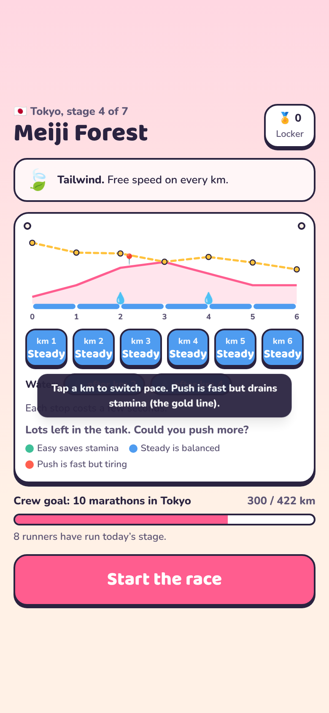
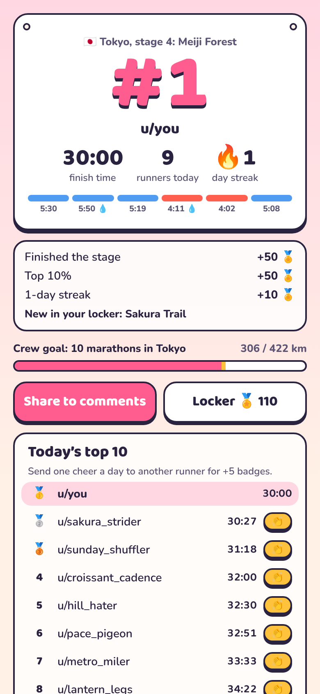

# Chibi City Marathon

A daily running game for Reddit. Every day the subreddit gets one new 6 km stage through the streets of a famous
city. You plan your pace, watch your chibi runner race it in 3D against the ghosts of everyone who ran before you,
and add your kilometres to the crew's shared goal: ten marathons in each city, one city a week.

Built on [Devvit Web](https://developers.reddit.com/docs/capabilities/devvit-web/devvit_web_overview) for
[Reddit's Daily Games Hackathon](https://redditgameofday2026.devpost.com/).

| Feed card                                       | Race plan                                  | Race                                        | Result                                        |
| ----------------------------------------------- | ------------------------------------------ | ------------------------------------------- | --------------------------------------------- |
|  |  |  |  |

## How to play

1. **Read the stage.** Each stage is 6 km with its own hills, water stations, landmark and weather. Everyone gets the
   same stage and the same weather that day.
2. **Plan your pace.** Tap each kilometre to switch between Easy, Steady and Push, and choose where to stop for water.
   The gold line shows your stamina. Push too hard and you will walk.
3. **Race.** A third-person 3D run down a closed city avenue: crowds, km gantries, water tables, the landmark,
   and the ghosts of other redditors running the same stage.
4. **Share and come back.** Your result is a race bib with your rank. Share it to the comments, cheer another runner,
   keep your streak, and help the crew finish the city.

One counted run per person per day. A new stage opens at 00:00 UTC.

## Features

- **Daily stages:** 3 cities (Tokyo, Paris, Hanoi) x 7 stages, rotating weekly, with 5 weather types picked by a
  date-seeded random so everyone gets the same conditions.
- **Strategy, not reflexes:** a deterministic stamina model (pace, grade, weather, water) decides your time. The server
  re-simulates every plan, so times cannot be faked.
- **Crew marathon:** every runner adds 6 km to the subreddit's goal of ten marathons (421.95 km) per city. When the crew
  finishes, everyone who ran that week gets badges and the city's hat.
- **Ghost runners:** the day's fastest redditors race beside you, in their own outfits.
- **Race bib result card:** rank, time, splits, streak and rewards on one screen, with share and cheer buttons.
- **Locker:** 19 cosmetic items and 4 pets that run with you (corgi, tabby cat, shiba, penguin), earned by streaks,
  city finishes and weather, or bought with badges. Cosmetics never change race times.
- **Reddit-native:** one post per day created by the scheduler with a pinned strategy thread, result sharing as a
  comment, a "City Finisher" user flair, and Devvit Journeys events for analytics.

## Tech

- Devvit Web: Interactive Post with a light inline feed card (`splash.html`) and an expanded game (`game.html`).
- Client: React 19, Tailwind CSS 4, three.js (all 3D is procedural; no model files).
- Server: Hono on Devvit's serverless Node, Redis for state, Devvit scheduler, Reddit API, `@devvit/analytics` journeys.
- Shared: the stage content, the race simulation and the economy run on both client and server.

```
src/
  shared/     content (cities, stages, weather), sim (stamina model), economy (items, pets, rewards), api types
  server/     core/game.ts (all game rules), core/store.ts (Redis interface + in-memory store), routes, devvit.ts
  client/     splash.tsx (feed card), game.tsx (app), screens/, components/, three/ (city, chibi, world)
  dev/        local harness: the real API with an in-memory Redis and a browser mock of @devvit/web/client
tests/e2e/    browser end-to-end script (Playwright)
```

## Develop

Requires Node 22+ (Devvit's CLI recommends Node 24).

```bash
npm install
npm run test:unit      # 32 unit tests: simulation, rules, API, daily posts
npm run test:types     # TypeScript
npm run lint
npm run dev:local      # play the whole game at http://localhost:5178 without Reddit
```

The local harness seeds four days of fake runners. Query parameters (kept as cookies) pick who and when you are:
`?user=alice` (empty for a logged-out guest), `?date=2026-11-13`, `?post=t3_dev1`. It also has helpers:
`POST /__dev/seed`, `POST /__dev/badges?n=1000`, `POST /__dev/crew?meters=400000`, `GET /__dev/state`.

Browser end-to-end check (19 checks, needs Playwright for Python):

```bash
npm run dev:local
python3 tests/e2e/play.py e2e-out/
```

## Run it on Reddit

```bash
npm run login                       # devvit login
npm run build
npx devvit upload                   # uploads a private app version (do not publish during the hackathon)
npx devvit playtest r/YourTestSub   # live reload on your test subreddit
```

Installing the app creates today's post. Moderators can also use the subreddit menu item
**Post today's marathon stage**. After that the `daily-stage` scheduler task posts a new stage every day at 00:01 UTC.

## Credits and licences

- Fonts: Baloo 2 and Nunito (SIL Open Font License) via Fontsource.
- Project template: Reddit's Devvit Web React template (BSD-3-Clause), see `LICENSE`.
- The city's facade technique (one floor-by-bay facade module repeated by UV, tinted per building, merged per material)
  is inspired by [my-office](https://github.com/khanh020905/my-office) (MIT).
- Landmarks are simplified, stylised shapes. All shop signs and brands in the game are fictional.
