# Running Man

A daily running game for Reddit. Every day the subreddit gets one new 6 km stage through the streets of a famous
city. You plan your pace, then steer your chibi runner down a busy 3D avenue: dodge cones and puddles, high-five fans,
and get past the other redditors who ran today without crashing into them. Every finish adds to the crew's shared goal:
ten marathons in each city, one city a week.

Built on [Devvit Web](https://developers.reddit.com/docs/capabilities/devvit-web/devvit_web_overview) for
[Reddit's Daily Games Hackathon](https://redditgameofday2026.devpost.com/).

- Play it: [r/RunningManGame](https://www.reddit.com/r/RunningManGame/)
- Watch the demo: [YouTube](https://youtu.be/CTI8BU9ABzw)
- Devpost: [Running Man](https://devpost.com/software/running-man-7dm4w8)
- App: [daily-running-man](https://developers.reddit.com/apps/daily-running-man)
- More screenshots, at full size: [docs/screenshots](https://github.com/agrhub/running-man/tree/main/docs/screenshots)

| Feed card                                                                                            | Make your runner                                                                                           | Race                                                                                             | Race bib                                                                                             |
| ---------------------------------------------------------------------------------------------------- | ---------------------------------------------------------------------------------------------------------- | ------------------------------------------------------------------------------------------------ | ---------------------------------------------------------------------------------------------------- |
| 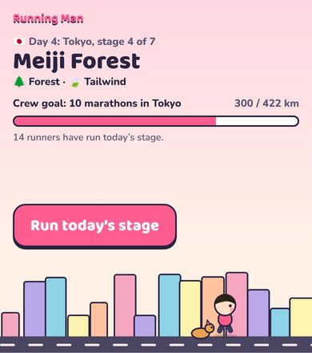 | 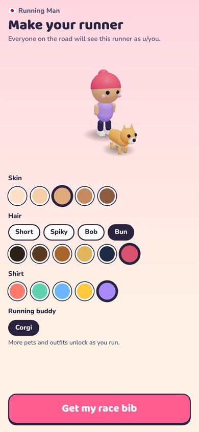 | 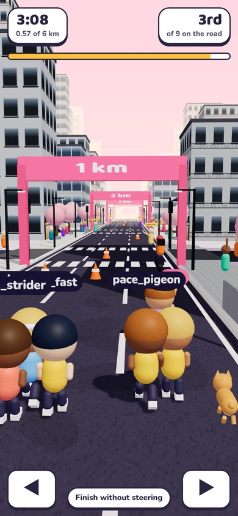 | 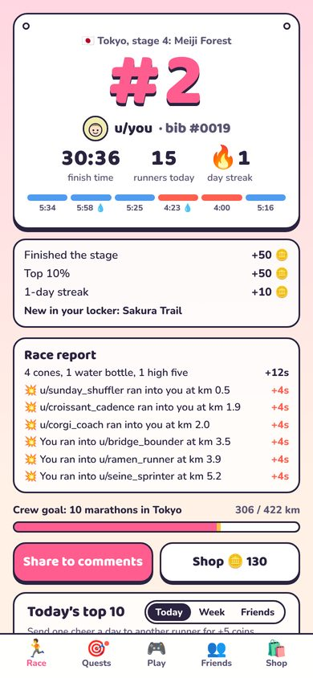 |

| Challenged on the feed                                                                                                      | Challenge a friend                                                                                                     | Real maps                                                                                            | Snack Dash                                                                                             |
| --------------------------------------------------------------------------------------------------------------------------- | ---------------------------------------------------------------------------------------------------------------------- | ---------------------------------------------------------------------------------------------------- | ------------------------------------------------------------------------------------------------------ |
| 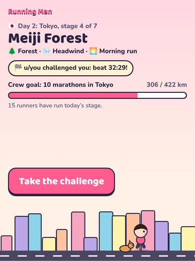 | 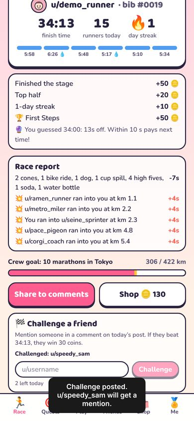 | 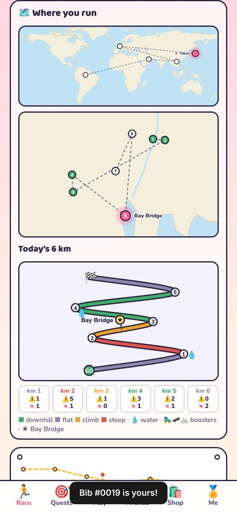 | 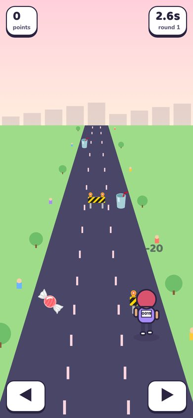 |

| World Tour                                                                                             | Pyramids of Giza                                                                                                  | Beach stage, Dubai                                                                                              | Amazon week                                                                                                       |
| ------------------------------------------------------------------------------------------------------ | ----------------------------------------------------------------------------------------------------------------- | --------------------------------------------------------------------------------------------------------------- | ----------------------------------------------------------------------------------------------------------------- |
| 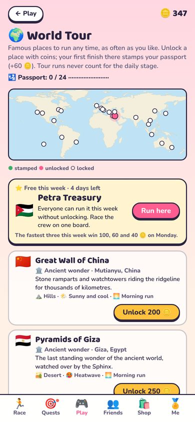 | 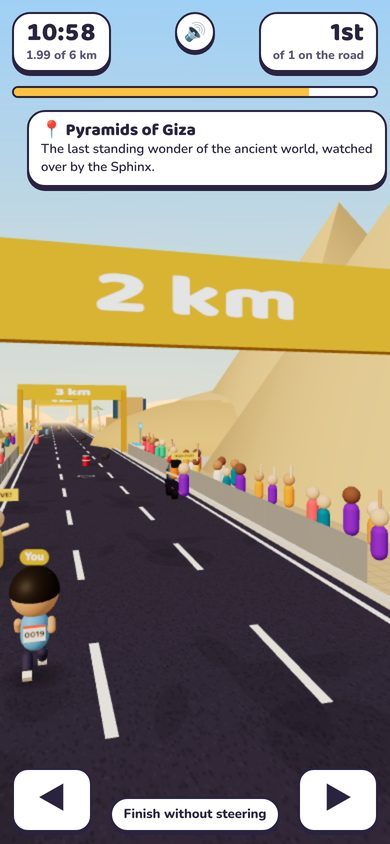 | 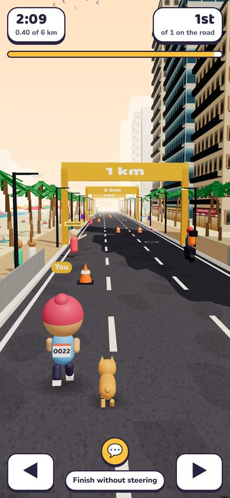 | 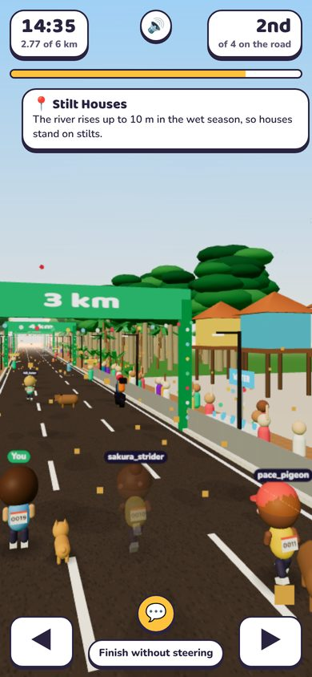 |

| Triathlon Finale                                                                                                 | Thunderstorm at dusk                                                                                                | Christmas Run                                                                                                | Shop                                                                                            |
| ---------------------------------------------------------------------------------------------------------------- | ------------------------------------------------------------------------------------------------------------------- | ------------------------------------------------------------------------------------------------------------ | ----------------------------------------------------------------------------------------------- |
| 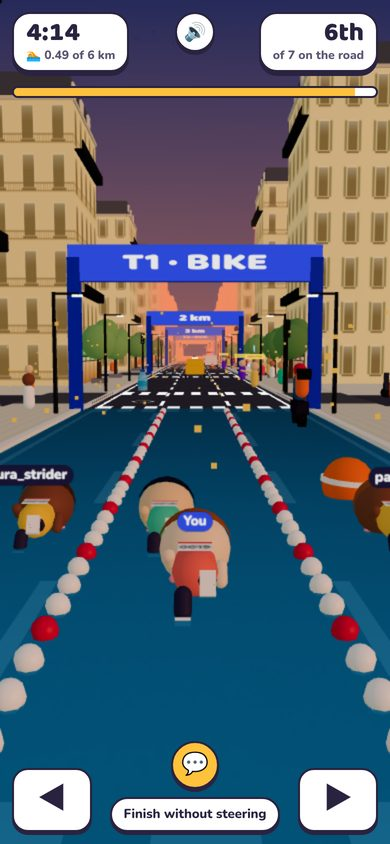 | 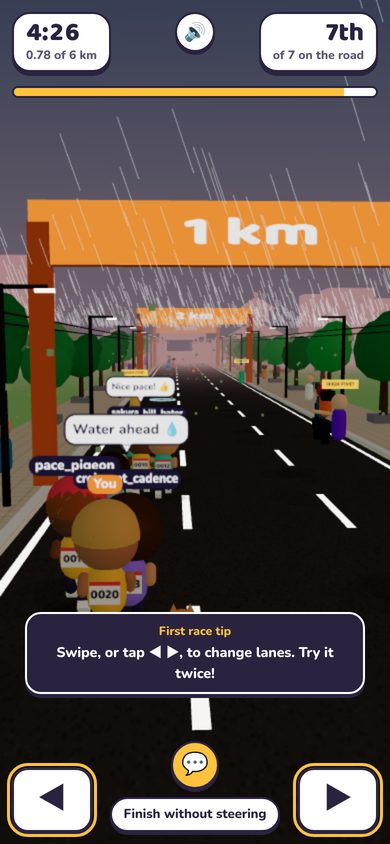 | 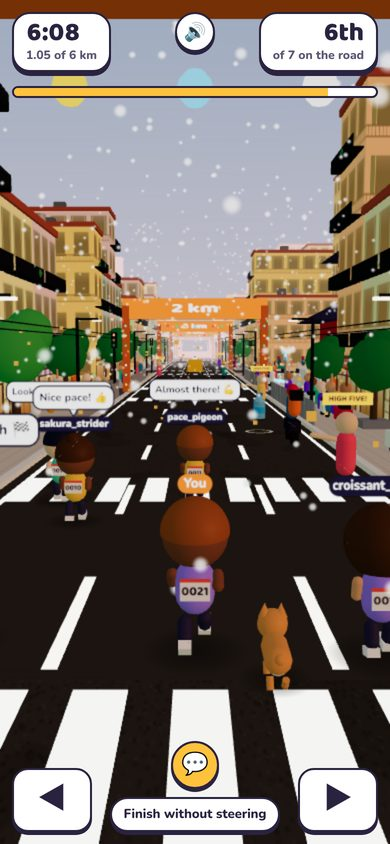 | 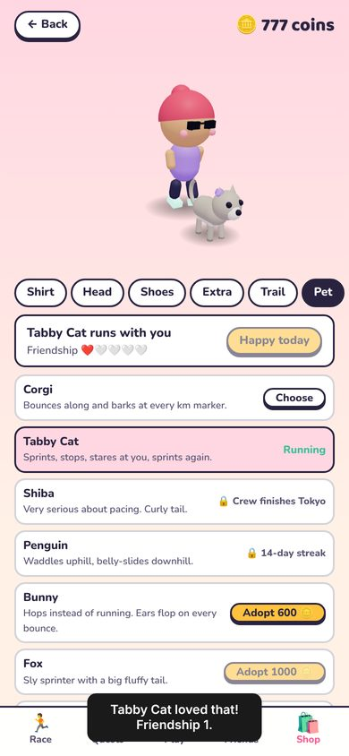 |

## How to play

1. **Make your runner.** The first time you open the game you pick skin, hair style and colour, a shirt and a running
   buddy, and get your own race bib number. Your Reddit username is your account; there is nothing else to sign up for.
2. **Read the stage.** Each stage is 6 km with its own terrain (city streets, park, forest, zoo, hills, beach or
   desert), hills, water stations, landmark and weather. Everyone gets the same stage and the same weather that day. The stage calendar is shared by every subreddit (a city week runs Monday to Sunday), while the day count in post titles starts at Day 1 on a subreddit's first stage.
3. **Plan your pace.** Tap each kilometre to switch between Easy, Steady and Push, and choose where to stop for water.
   The gold line shows your stamina. Push too hard and you will walk.
4. **Line up and race.** The start corral shows your bib, your start lane and who is on the road with you. Then a
   third-person run down a closed road with three lanes. Swipe, tap ◀ ▶ or use the arrow keys to change lanes. Cones,
   puddles and dropped cups cost seconds; water bottles, soda, cake, candy and high fives from the crowd give a burst
   of speed. Tap 💬 to shout one of eight quick-chat lines; other runners see it above your head when they run.
   The other runners on the road are today's real players, running exactly where they ran. Run into one, or let one
   run into you, and you **both fall and lose 4 seconds**, and the crash is written into both official times.
5. **Share and come back.** Your result is a race bib with your rank. Share it to the comments, cheer another runner,
   keep your streak, and help the crew finish the city.
6. **Between races.** The tab bar at the bottom has the rest of the game: **Quests** (daily check-in and quests),
   **Play** (four mini games: Snack Dash, Hurdle Hop, Rhythm Steps, Pet Fetch), **Friends** (friends and running clubs), the **Shop** (outfits,
   pets and pet gear) and **Me** (your profile, achievements and options). Everything pays in coins 🪙.

One counted run per person per day. A new stage opens at 00:00 UTC.

## Features

- **Daily stages:** 5 places (Tokyo, Paris, Hanoi, Dubai and the Amazon) x 7 stages, rotating weekly, across 8
  terrains (city, park, forest, zoo, hills, beach, desert, rainforest), with 6 weather types (sunny, heat, rain, thunderstorm, headwind,
  tailwind) and 4 start times (morning, noon, afternoon, evening) picked by a date-seeded random so everyone gets the
  same conditions. You see them on the road: sun and sky follow the clock, rain falls, storms flash, leaves blow.
- **Triathlon Finale:** stage 7 of every city is swim, bike, run: a pool with lane ropes and buoys for the first km,
  bikes from T1 to T2, then the run, each leg with its own pace model.
- **The Amazon:** Manaus and the rainforest: an opera house with a tiled dome, a giant kapok tree, a canopy walkway,
  stilt houses, the black Rio Negro, giant water lilies and the Meeting of the Waters, with a river, canoes and
  macaws beside the trail, capybaras and monkeys in the lanes, and an Amazon Explorer Hat for the finishers.
- **Life on the road:** people crossing, cyclists, motorbikes, cyclos, taxis, ambulances and fire engines, dogs,
  cats, chickens and pigs, depending on the city, terrain and hour; and boosters to ride (roller skates, a
  skateboard, a bicycle).
- **First race coach:** four tips during your first race, each when it is useful.
- **Real maps:** the plan screen shows where you run on real maps: a world map of the five-city rotation (or of the
  World Tour), then a close map of the city with its real coastline, rivers and lakes and the week's seven stages
  pinned at their real landmarks (today highlighted, past stages ticked). World Tour stops get a map of their region.
  Below it, today's 6 km as a course map: coloured by grade, km marks, water stops (faded when your plan skips them),
  the landmark, the boosters and how many obstacles and snacks each km holds, from the same seeded course the race
  uses.
- **Runner and race bib:** a short character creator on first launch (skin, 4 hair styles, hair colour, shirt, and a pet once you own one),
  a bib number that is yours for good and printed on your runner's back, and a start corral before each race.
- **Strategy first, then steering:** a deterministic stamina model (pace, grade, weather, water) decides most of your
  time; steering decides the rest (a few dozen seconds at most).
- **A real field, real crashes:** today's runners race on the road with you in their own lanes and outfits. Collisions
  knock both runners down; the other runner's leaderboard time, splits and result card are updated too, with a race
  report of who ran into whom. Runners line up across all three lanes at the start, and nobody runs into someone who is
  still getting up. The same two runners crash at most once per race, and runners between the camera and you fade so
  you never lose your runner in a crowded start.
- **Snacks on the road:** water bottles, soda, cake and candy speed you up; cones, puddles and cups slow you down.
  Every item is placed by the date, so everyone faces the same road.
- **Quick chat:** eight friendly preset lines (no free text, so nothing to moderate) shown as speech bubbles, saved
  with your run and replayed for everyone who runs after you, plus automatic reactions when you crash or grab a snack.
- **Sound and vibration:** every sound is synthesised in the browser (no audio files): countdown, footsteps that
  follow your pace, a soundscape per terrain (crowd, waves, desert wind, birds), crashes, snacks, high fives, km gates
  and a finish fanfare. Phones buzz on a crash. One tap mutes it, and the choice is remembered.
- **Next-city vote:** after a run, everyone who ran a stage that week gets one vote for the next city to build
  (London, New York, Seoul or Rio), counted on the server.
- **Cheat-proof:** the client sends only the plan and the lane changes. The server replays the whole race step by step
  (same course, same runners) and records the time it computes.
- **Crew marathon:** every runner adds 6 km to the subreddit's goal of ten marathons (421.95 km) per city. When the crew
  finishes, everyone who ran that week gets coins and the city's hat.
- **A living world:** floor-scale buildings in each city's style, shops, street trees, park lawns and ponds, forest,
  zoo animals behind fences, rolling hills, a beach with sea, boats and umbrellas, desert dunes with a camel caravan,
  traffic on the cross streets that
  queues at the marshals and turns round, waving crowds, birds, balloons, a TV motorbike filming the leaders, confetti
  at the finish, and a landmark moment on every stage.
- **Race bib result card:** rank, time, splits, streak and rewards on one screen, with share and cheer buttons.
- **Leaderboards:** today's top 10, this week's standings (most stages, then the lowest total time) and a Friends
  board, each with the players' own Reddit avatars.
- **Coins and the shop:** coins come from races, the check-in, quests, achievements and the mini games. The shop has 33 outfit items,
  7 pets to adopt with coins (corgi, bunny, tabby cat, shiba, fox, penguin, panda; nobody starts with one) and pet
  gear (collar, bandana, bow, cap, shades, crown) drawn on every pet, plus rest days (150 coins, hold up to 2) that are
  used up on their own when you miss a day so your streak carries on. Some outfit items are earned by streaks, city finishes and weather instead. Nothing you buy
  changes race times.
- **Daily check-in and quests:** a 7-day check-in calendar (20 to 150 coins), three daily quests that are the same
  for everyone (run today, grab snacks, high-five fans, finish without a crash…) and weekly quests. The server checks
  every quest against what really happened.
- **Snack Dash:** a 20-second mini game on three lanes: catch snacks, dodge cones, build a combo. Every round's
  course comes from the date and the server replays your lane changes to score it. The first three rounds a day pay
  up to 50 coins each, with a daily top five.
- **Three more mini games:** Hurdle Hop (tap to jump, faster and faster), Rhythm Steps (tap on a rising beat) and Pet
  Fetch (stop the power bar to throw for your pet, with wind), each scored on the server from its tap times, with
  coins for the first rounds and a daily top five.
- **World Tour:** 24 famous places to run any time, outside the daily calendar: the Great Wall, the Pyramids of
  Giza, Machu Picchu, the Colosseum, the Taj Mahal, Angkor Wat, Stonehenge, Petra, Ha Long Bay, the Grand Canyon,
  Niagara Falls, the Moai of Easter Island, Mount Fuji, the Statue of Liberty, the Sydney Opera House, Christ the
  Redeemer, Chichén Itzá, the Parthenon, Uluru, the Matterhorn, the Leaning Tower of Pisa, the Golden Gate Bridge,
  Borobudur and Cappadocia, each with its own low-poly 3D wonder, terrain, weather, hour and real map.
  One place is free for everyone each week, and its three fastest runners win coins when the week ends. Unlock the others with coins (200 to 350), run it as often as you like against the best runs there as ghosts (the
  server replays every run), and the first finish stamps your passport for 60 coins. Tour runs never touch the daily
  leaderboard, streak or crew goal.
- **Friends:** add friends by username or from today's runners, see their day, race them on the Friends board. Friends
  who ran today join your road first with their own tag colour.
- **Call your time:** guess your finish in the start corral; within 10 seconds pays 30 coins, within 3 pays 60.
- **Club relay:** the first three clubmates to run each day form a relay, ranked on a daily relay board.
- **Running clubs (group runs):** start a club (named from word lists, so nothing to moderate) and invite others with
  a 6-character code. Clubmates share your road with purple tags, and clubs compete on weekly km.
- **Reddit avatars:** each player's own Reddit avatar appears next to their name, looked up by the server and cached
  for a day, with a coloured initial when there is none.
- **Profile and achievements:** a Me tab with your run calendar, bests per city, fourteen achievements that pay
  coins, and comfort options (calm motion, bigger buttons, one-thumb steering, vibration, language).
- **English, Spanish, Brazilian Portuguese and Vietnamese:** every screen, tip, toast and piece of game data (stages, landmarks, weather, items,
  pets, quests, achievements, mini games, World Tour, server messages) is translated. The language follows the
  device and can be changed in Me → Options; public Reddit posts stay in English. `npm run i18n:check` lists any
  text without a translation.
- **Holiday season:** snow, lights and trees on every December stage, Santa hats for December runners, and a
  Christmas Run with double coins on the 25th.
- **Daily recap and celebrations:** the app comments a recap under each closed stage and posts when the crew
  finishes a city; the plan screen shows yesterday's podium.
- **Challenge a friend:** after your run, call out up to three redditors by name. The app comments in today's post as
  you ("u/bob, I challenge you!"), so Reddit notifies them; the feed card and their plan screen show the challenge, and beating your time
  pays them 30 coins. When they finish, the app replies with the outcome and mentions you back.
- **Moderator settings:** quick chat, road life, pinning, recaps, app posts and runner flair can each be switched off.
- **Reddit-native:** one post per day created by the scheduler and pinned to the top of the subreddit, with a pinned
  strategy thread, a how-to-play post pinned on install, result sharing as a
  comment, a live runner user flair (`🏃 #0019 · 12 stages · 🛂 3 · 🏅 Tokyo Finisher`), and Devvit Journeys events for analytics.

## Tech

- Devvit Web: Interactive Post with a light inline feed card (`splash.html`) and an expanded game (`game.html`).
- Client: React 19, Tailwind CSS 4, three.js (all 3D is procedural; no model files).
- Server: Hono on Devvit's serverless Node, Redis for state, Devvit scheduler, Reddit API, `@devvit/analytics` journeys.
- Shared: the stage content, the race simulation and the economy run on both client and server.

```
src/
  shared/     content (cities, stages, weather), sim (stamina model), course (cones, fans), race (the step-by-step
              race with lanes and collisions, run by client and server), chat (quick-chat lines), economy (items, pets,
              rewards), api types
  server/     core/game.ts (all game rules), core/store.ts (Redis interface + in-memory store), routes, devvit.ts
  client/     splash.tsx (feed card), game.tsx (app), screens/, components/, three/ (city, terrain, chibi, world)
  dev/        local harness: the real API with an in-memory Redis and a browser mock of @devvit/web/client
tests/e2e/    browser end-to-end script (Playwright)
```

## Develop

Requires Node 22+ (Devvit's CLI recommends Node 24).

```bash
npm install
npm run test:unit      # 125 unit tests: simulation, race replay, collisions, rules, API, daily posts, i18n
npm run test:types     # TypeScript
npm run lint
npm run dev:local      # play the whole game at http://localhost:5178 without Reddit
```

The local harness seeds four days of fake runners. Query parameters (kept as cookies) pick who and when you are:
`?user=alice` (empty for a logged-out guest), `?date=2026-11-13`, `?post=t3_dev1`. It also has helpers:
`POST /__dev/seed`, `POST /__dev/badges?n=1000`, `POST /__dev/crew?meters=400000`, `GET /__dev/state`.

Browser end-to-end check (55 checks: register, check-in, corral, first-race coach, steering, sound, chat, result,
vote, weekly and friends boards, quests, Snack Dash, Pet Fetch, friends, clubs, profile and options, shop, replay; needs
Playwright for Python):

```bash
npm run dev:local
python3 tests/e2e/play.py e2e-out/
```

## Run it on Reddit

```bash
npm run login                       # devvit login
npm run build
npx devvit upload                   # uploads a private app version (do not publish during the hackathon)
npx devvit playtest r/YourTestSub   # live reload on your test subreddit
```

Step-by-step instructions for the hackathon upload are in [docs/DEPLOY.md](https://github.com/agrhub/running-man/blob/main/docs/DEPLOY.md). The full game design is in [docs/DESIGN.md](https://github.com/agrhub/running-man/blob/main/docs/DESIGN.md).

Installing the app creates today's post. Moderators can also use the subreddit menu item
**Post today's marathon stage**. After that the `daily-stage` scheduler task posts a new stage every day at 00:01 UTC.

## Credits and licences

- Fonts: Baloo 2 and Nunito (SIL Open Font License) via Fontsource.
- Map outlines: [Natural Earth](https://www.naturalearthdata.com/) (public domain) via
  [world-atlas](https://github.com/topojson/world-atlas) (ISC), built into `src/client/lib/mapData.ts` by
  `npm run build:maps`. Rivers and lakes on the city maps are traced by hand from their real coordinates.
- Code: MIT, see `LICENSE`.
- Project template: Reddit's Devvit Web React template (BSD-3-Clause), see `THIRD_PARTY_NOTICES.md`.
- The city's facade technique (one floor-by-bay facade module repeated by UV, tinted per building, merged per material)
  is inspired by [my-office](https://github.com/khanh020905/my-office) (MIT).
- Landmarks are simplified, stylised shapes. All shop signs and brands in the game are fictional.
